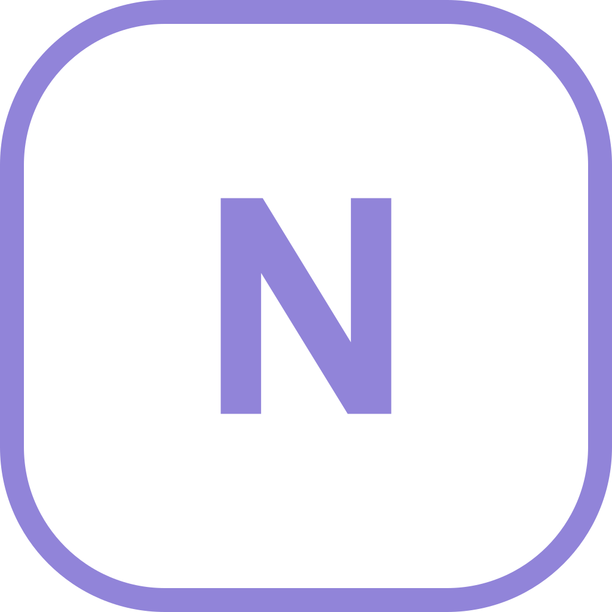
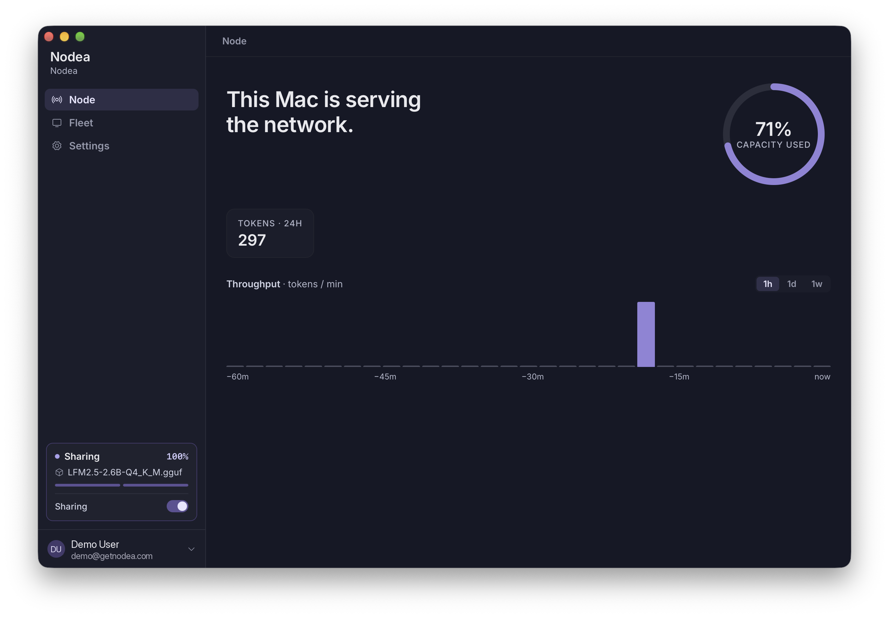

<p align="center">
  <a href="https://getnodea.com"></a>
</p>
<h1 align="center">Nodea Desktop</h1>
<p align="center"><b>Your next inference cluster is already on your desks.</b></p>

<p align="center">
  <a href="https://getnodea.com">Website</a> •
  <a href="https://getnodea.com/docs/">Docs</a> •
  <a href="https://github.com/nodea-sh/nodea-client/releases/latest">Download</a> •
  <a href="#privacy-and-security">Privacy &amp; security</a> •
  <a href="docs/DEVELOPMENT.md">Build from source</a>
</p>

<p align="center">
  <a href="https://github.com/nodea-sh/nodea-client/releases/latest"></a>
  <a href="LICENSE"></a>
</p>

<p align="center">
  
</p>

Nodea pools the idle memory in the laptops, towers and GPU workstations your
organization already owns into one private inference fleet. Install Nodea
Desktop, sign in and switch on sharing: the machine starts serving open-weight
models to your organization, and it stays yours to switch off.

## Download

| Platform | Download | Notes |
| --- | --- | --- |
| macOS (Apple Silicon) | [Nodea-mac.dmg](https://github.com/nodea-sh/nodea-client/releases/latest/download/Nodea-mac.dmg) | Signed and notarized · Metal |
| Windows | [Nodea-windows.msi](https://github.com/nodea-sh/nodea-client/releases/latest/download/Nodea-windows.msi) | Preview · Vulkan (NVIDIA, AMD, Intel) or CPU |
| Linux | [Nodea-linux.AppImage](https://github.com/nodea-sh/nodea-client/releases/latest/download/Nodea-linux.AppImage) | Preview · Vulkan (NVIDIA, AMD, Intel) or CPU |

A Nodea account is needed to serve requests: [sign up at getnodea.com](https://app.getnodea.com/signup).
Every release ships a `SHA256SUMS` file and build-provenance attestations
([verify a download](docs/DEVELOPMENT.md#verifying-a-download)).

## Features

- **Share compute** with one toggle, and stop with the same toggle.
- **Live node status**: capacity in use, tokens served and throughput over time.
- **Fleet view** of every device connected to your organization.
- **Local inference with llama.cpp**: Metal on macOS, Vulkan on Windows and Linux, CPU fallback.
- **Managed models**: the models your organization assigns are downloaded and cached automatically.
- **Team onboarding**: sign in with email or Google, and join an organization from an invitation link.
- **In-app updates**: signed updates, installed when you choose.

## Privacy and security

What Nodea Desktop does on your machine:

- **Prompts and completions are never logged.** Requests reach this machine
  through Nodea's backend, and the generated tokens go back the same way.
- **Only device metadata is reported:** a random device ID, hostname, OS and
  architecture, app version, total, available and GPU memory, and which models
  are cached, plus a heartbeat every 5 seconds while connected.
- **Network access is limited to** the Nodea API, Nodea's authentication
  provider (Supabase), huggingface.co for model downloads and github.com for
  updates. There is no telemetry or analytics.
- **Local data** (sign-in tokens, the device ID and model files) stays in the
  app's data directory.
- **Models** come from Hugging Face, and each is under its own licence (Llama,
  Gemma, Qwen, …) and acceptable-use policy.

To stop serving, switch off **Sharing** or sign out. To report a
vulnerability, see [SECURITY.md](SECURITY.md).

## How it works

Nodea Desktop is a native app built with Tauri: a Rust core with a React
interface. It keeps one authenticated gRPC stream open to the Nodea backend,
which routes your organization's requests to available nodes. All model
execution is in a self-contained crate on top of llama.cpp
(`src-tauri/crates/nodea-inference`). The backend is a hosted service and is
not part of this repository.

## Build from source

```bash
npm install
cp .env.example .env.local
npm run tauri:local
```

Prerequisites, configuration, testing and the release process are covered in
[docs/DEVELOPMENT.md](docs/DEVELOPMENT.md). Contributions are welcome. See
[CONTRIBUTING.md](CONTRIBUTING.md).

## License

Nodea Desktop is licensed under the [Apache License 2.0](LICENSE) (see also
[NOTICE](NOTICE)). The licence texts of the third-party code it bundles are in
[THIRD_PARTY_LICENSES.md](THIRD_PARTY_LICENSES.md).
Models are not part of this software and carry their own licences.

<p align="center"><sub><a href="https://getnodea.com">getnodea.com</a> · <a href="mailto:hello@getnodea.com">hello@getnodea.com</a></sub></p>
